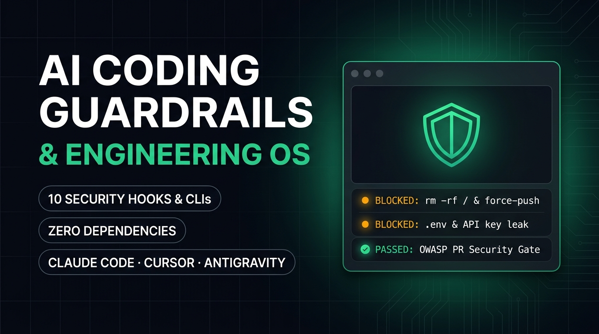

<p align="center">
  
</p>

# AI Agent Guardrails Lite (Zero-Dependency Node.js)

**Drop-in `PreToolUse` security hooks + an OWASP PR Security Auditor for Claude Code, Cursor, Windsurf, VS Code Copilot & Google Antigravity — 100% free & MIT licensed.**

Zero `npm install`. Zero supply-chain dependencies. Runs anywhere Node.js 18+ is installed (Windows, macOS, Linux).

---

## Included Free in This Repo (MIT)

| Component | What It Blocks / Audits |
| :--- | :--- |
| **`hooks/01-hook-block-dangerous-shell.mjs`** | Blocks `rm -rf /`, `git push --force main`, `git reset --hard`, `DROP TABLE`, `curl \| sh`, `chmod 777`, disk wipes & `.env` exfiltration (exit `2` in Claude Code `PreToolUse`) |
| **`hooks/02-hook-secret-leak-guard.mjs`** | Scans Write/Edit tool payloads & `git diff --cached` for 11 secret types (AWS, OpenAI, Anthropic, Stripe, GitHub, JWT, Private Keys, DB URLs) — always masks values |
| **`hooks/03-hook-protected-files-guard.mjs`** | Prevents AI agents from modifying `.env*`, `*.pem/*.key`, `.ssh`, lockfiles, `.git/`, and `terraform.tfstate` |
| **`clis/06-cli-pr-security-auditor.mjs`** | 14-rule OWASP + Secret scanner for staged diffs, PR branches, or folders — outputs JSON or Markdown PR review tables |
| **`rulebooks/`** | 2 production starter rulebooks (Next.js App Router + Drizzle & OWASP Top 10 AI Hardening) |
| **`.claude/settings.json`** | Ready-to-drop Claude Code hook wiring |

---

## Quickstart (30 Seconds)

```bash
git clone https://github.com/danlopes18-ctrl/ai-agent-guardrails-lite.git
cd ai-agent-guardrails-lite

# 1. Test dangerous shell command blocking (exits 2 -> BLOCKED)
node hooks/01-hook-block-dangerous-shell.mjs --cmd "git push --force origin main"

# 2. Test protected file guard (exits 2 -> BLOCKED)
node hooks/03-hook-protected-files-guard.mjs --path ".env.production"

# 3. Audit any repository for OWASP & secret leaks
node clis/06-cli-pr-security-auditor.mjs --dir /path/to/your/repo --markdown
```

---

## Want the Complete 35+ File Engineering OS? (PRO)

Upgrade to **[AI Coding Guardrails & Engineering OS v1.0 ($49 · Commercial & Agency License)](https://danlopes3.gumroad.com/l/ai-coding-guardrails-os)** to unlock:
- **All 10 Executable Hooks & CLIs** (adds `04-hook-auto-verify-gate`, `05-hook-scope-creep-detector`, `07-cli-context-packer` with token budget + secret redaction, `08-cli-prompt-eval-runner`, `09-cli-agent-cost-tracker` with USD budget cap, and `10-cli-skill-scaffolder` across Claude/Cursor/Windsurf/Antigravity)
- **All 8 Deep Architecture Rulebooks** (Next.js/Drizzle, FastAPI/SQLAlchemy, Node/TS Microservices, React Native/Expo, Go, OWASP, Vitest/Playwright, Legacy Zero-Regression)
- **All 12 Senior Engineering Slash Skills** (Incident Forensics, Zero-Downtime DB Migrations, Perf Benchmarking, API Contract Audits, Webhook Idempotency & more)
- **One-Command Cross-IDE Installer (`install.mjs`) + GitHub Actions PR Guardrails CI Workflow**

Also check out our other open-source AI engineering kits:
- [MCP Starter Suite Lite (MIT)](https://github.com/danlopes18-ctrl/mcp-starter-suite-lite) — 3 hardened zero-dep MCP servers + Inspector CLI
- [AI Automation Vault Lite (MIT)](https://github.com/danlopes18-ctrl/ai-automation-vault-lite) — 5 standard-node n8n workflows + n8n MCP bridge
---

### 🎁 Save $38 — Complete AI Engineering Stack Bundle ($79 vs $117)

Want all 3 zero-dependency developer suites together? Grab the **[Complete AI Engineering Stack Bundle ($79 · Commercial License)](https://danlopes3.gumroad.com/l/complete-ai-engineering-stack)**:
- **AI Agency & DevOps Automation Vault ($29)** — 25 standard-node n8n workflows + 3 MCP servers
- **Production MCP Server Suite ($39)** — 12 hardened zero-dependency Node.js MCP servers + Universal Inspector CLI
- **AI Coding Guardrails & Engineering OS ($49)** — 10 executable PreToolUse/PostToolUse hooks & OWASP CLIs + 8 rulebooks + 12 slash skills
